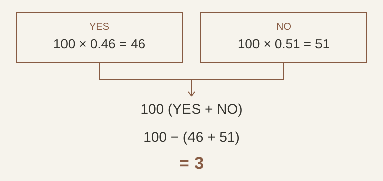

+++
title = "The Maths Behind PolyArb"
description = "Working through YES–NO arbitrage, fees paid in shares, order-book depth, and the gap between a paper trade and a live fill."
date = 2026-10-29
updated = 2026-11-12
draft = false

[taxonomies]
categories = ["2026"]
tags = ["web3", "math", "quantitative finance", "rust"]

[extra]
lang = "en"
topic = "Web3"
toc = true
comment = true
copy = false
math = true
reaction = true
+++

PolyArb looks for Polymarket YES and NO shares that together cost less than USD 1 after fees. The first calculation fits on one line. Deciding how much to buy takes more work, because the displayed prices may cover only a few shares, fees can reduce the shares received, and the two orders can fill differently.

This post explains the general mathematics behind the [PolyArb project](@/projects/polyarb.md). The source code is not publicly shared. All prices and trading outcomes below are hypothetical. They are examples for checking the arithmetic, not results from a live run.

## Why a pair is worth USD 1

Take a binary market and let its YES payout be $X$. The complementary NO payout is $1-X$. Holding one of each gives

$$
X+(1-X)=1.
$$

The shares must belong to the same condition and form a complete complementary set. Buying YES on one question and NO on a similar question does not establish this identity. Polymarket's [portfolio documentation](https://legacy-docs.polymarket.com/faq/trading) describes merging a matching pair back into collateral.

For equal quantities $q$, ignoring fees and other costs, buying at prices $p_Y$ and $p_N$ gives the profit

$$
\pi(q)=q(1-p_Y-p_N).
$$

Suppose YES costs USD 0.46 and NO costs USD 0.51. Buying 100 of each costs USD 97. The complete set has a USD 100 payout, leaving a gross USD 3 spread. This calculation assumes both quantities are acquired at those prices and the complete set can be converted or settled as expected.

<figure>

</figure>

## Buy fees can leave fewer pairs than ordered

A useful first model subtracts a dollar fee from that USD 3. A model for fees deducted from received shares needs to account for the smaller net balances.

Let a hypothetical model use a fee rate $r$ and an exponent $e$ to calculate the dollar fee per gross share at price $p$ as

$$
f(p)=r[p(1-p)]^e.
$$

This is a parameterised example. It should not be read as a universal fee schedule for every market. The market's applicable fee rules and parameters still need to be checked.

Converting the dollar fee into shares gives a retained fraction

$$
a(p)=1-\frac{f(p)}{p}.
$$

If both orders buy $q$ gross shares at fixed prices, the net balances become $q\,a(p_Y)$ and $q\,a(p_N)$. The number of complete pairs is limited by the smaller balance:

$$
m=q\min\{a(p_Y),a(p_N)\}.
$$

Valuing any unmatched remainder at zero gives a conservative paired profit, before other costs,

$$
\pi_{\mathrm{pair}}=m-q(p_Y+p_N).
$$

Use the earlier prices and assume, only for this example, $r=0.02$ and $e=1$. Then

$$
a(0.46)=1-0.02(0.54)=0.9892,
$$

$$
a(0.51)=1-0.02(0.49)=0.9902.
$$

Orders for 100 shares on each side leave 98.92 YES shares and 99.02 NO shares. Only 98.92 pairs are covered by the complete-set calculation. Against the USD 97 purchase cost, that leaves USD 1.92 before other costs. There are also 0.10 unmatched NO shares; this bound assigns them no value.

For a range of possible fill prices, a conservative estimate can use the smallest retained fraction across that range. Fees and purchase costs must use consistent units.

## The cheapest price may cover only a small order

Suppose the asks are:

| Side | Price | Shares available at that price |
| --- | ---: | ---: |
| YES | USD 0.46 | 20 |
| YES | USD 0.50 | 80 |
| NO | USD 0.51 | 100 |

The first 20 pairs cost USD 0.97 each before fees. Buying 100 YES shares requires taking the next level too. The actual cost of buying 100 shares on both sides, if this book remains available, is

$$
C(100)=20(0.46)+80(0.50)+100(0.51)=100.20.
$$

Even with no fees, the USD 100 paired payout would leave a USD 0.20 loss. Multiplying the best displayed prices by 100 would have reported a USD 3 profit.

A depth-aware calculation can evaluate quantities at depth breakpoints, subject to budget and size constraints. For a candidate size $q$, it finds the limit prices $L_Y(q)$ and $L_N(q)$ needed to reach that quantity. A conservative cost bound is

$$
C_{\max}(q)=q[L_Y(q)+L_N(q)].
$$

At $q=100$, this bound is USD 101. At $q=20$, it is USD 19.40. The bound charges every share at its leg's limit price, so it can exceed the cost calculated by walking the book.

## A profitable plan still needs two fills

The cost and payout bounds assume both legs fill in the required quantities. They do not guarantee that execution will produce those balances.

Suppose the YES order fills for 100 shares but the NO order fills for only 30. Ignore fees here to isolate the quantity mismatch. The holdings can be written as

$$
100Y+30N=30(Y+N)+70Y.
$$

Thirty complete pairs have a USD 30 combined payout. The remaining 70 YES shares depend on the outcome or on the price available when they are sold. If the bot tries to complete the hedge, it may have to pay more for NO than the original plan allowed.

For arbitrary net balances $n_Y$ and $n_N$, the complete-pair quantity is $\min(n_Y,n_N)$. The unmatched quantity is $|n_Y-n_N|$. A record of submitted orders cannot establish either number; execution records must show what filled and what fees were deducted.

These bounds require fresh market data, matching token identities, and both fills. Stale data or a missing leg can invalidate a proposed trade.

## From a price observation to an execution record

A technical workflow needs to preserve enough evidence to reconstruct each decision. Start with both order books for the same condition, their observation times, and the fee parameters used for the calculation. Reject a candidate if either book is too old under the chosen freshness policy.

Next, calculate an affordable quantity from executable depth and net shares after fees. Apply limits on order cost and unmatched exposure before submitting orders. A positive spread alone does not answer either question.

After submission, track each leg independently. Record the requested quantity, filled quantity, average fill price, deducted fees, and remaining order quantity. Reconcile those records against the resulting balances before counting complete pairs. An order acknowledgement confirms receipt of a request; it does not confirm a fill.

These are general design requirements for evaluating a paired-trade system. They do not describe or expose PolyArb's private implementation.

## What I would check in a paper-trading result

PolyArb is now in production and also supports paper trading. This section concerns simulated results, not evidence of live returns. Paper trading uses real market prices and simulated orders, with balances that persist across restarts.

The dashboard helps inspect activity, but a detected price gap, a risk-approved decision, a simulated fill, and realised profit describe different stages. To assess a run, I would check which prices and quantities were observed, how old the book was, which fee parameters were used, and how the simulator decided that each order filled.

For a completed trade, the accounting should include the paired collateral actually recovered, proceeds or remaining value from unmatched shares, the purchase cost, and other execution costs. With consistent units, that is

$$
\pi_{\mathrm{net}}=M+U-C-K,
$$

where $M$ is recovered paired collateral, $U$ is the unmatched inventory's proceeds or marked value, $C$ is the purchase cost, and $K$ covers additional costs not already deducted. If $U$ includes unsold inventory, part of this figure remains unrealised.

Before treating a paper balance as evidence of live profitability, I would compare its assumed fills with the depth and timestamps recorded for each leg. A simulator that grants both fills at the observed prices has already assumed away the execution failure in the previous example.
