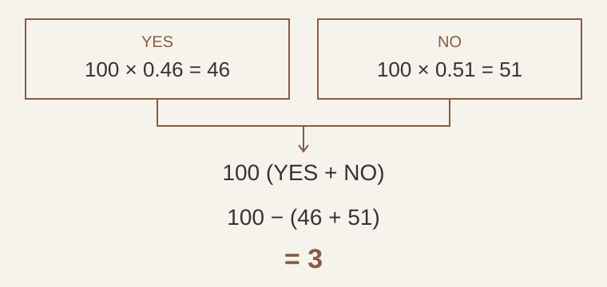

+++
title = "The Maths Behind Polymarket binary-pairs arbitrage"
description = "Working through YES–NO arbitrage, fees paid in shares, order-book depth, and the gap between a paper trade and a live fill."
date = 2026-10-29
updated = 2026-11-12
draft = false

[taxonomies]
categories = ["2026"]
tags = ["web3", "quantitative finance", "mathematics"]

[extra]
lang = "en"
topic = "Web3"
toc = true
comment = true
copy = false
math = true
reaction = true
+++

Polymarket binary-pairs arbitrage looks for Polymarket YES and NO shares that together cost less than USD 1 after fees. That check fits on one line. Sizing the trade is harder: the displayed prices may cover only a few shares, fees can reduce the shares received, and the two orders can fill differently.

This post covers the general maths behind the [Polymarket binary-pairs arbitrage project](@/projects/polyarb.md). The source code is not public. All prices and outcomes below are hypothetical examples for checking the arithmetic, not results from a live run.

## Why a pair is worth USD 1

In a binary market, let the YES payout be $X$, so NO pays $1-X$. Holding one of each gives

$$
X+(1-X)=1.
$$

The shares must belong to the same condition and form a complete set. YES on one question and NO on a similar question does not count. Polymarket's [portfolio documentation](https://legacy-docs.polymarket.com/faq/trading) describes merging a matching pair back into collateral.

Buying equal quantities $q$ at prices $p_Y$ and $p_N$, ignoring fees and other costs, gives the profit

$$
\pi(q)=q(1-p_Y-p_N).
$$

Suppose YES costs USD 0.46 and NO costs USD 0.51. Buying 100 of each costs USD 97 and pays USD 100, a gross USD 3 spread. This assumes both sides fill at those prices and the set settles as expected.

<figure>

</figure>

## Buy fees can leave fewer pairs than ordered

A first model subtracts a dollar fee from that USD 3. When fees come out of the shares received, the model must use the smaller net balances.

In a hypothetical model with fee rate $r$ and exponent $e$, the dollar fee per gross share at price $p$ is

$$
f(p)=r[p(1-p)]^e.
$$

This is a parameterised example, not a universal fee schedule; check each market's actual fee rules.

Converting the fee into shares gives a retained fraction

$$
a(p)=1-\frac{f(p)}{p}.
$$

If both orders buy $q$ gross shares at fixed prices, the net balances are $q\,a(p_Y)$ and $q\,a(p_N)$. The smaller balance limits the complete pairs:

$$
m=q\min\{a(p_Y),a(p_N)\}.
$$

Valuing any unmatched remainder at zero gives a conservative paired profit before other costs:

$$
\pi_{\mathrm{pair}}=m-q(p_Y+p_N).
$$

With the earlier prices and, for this example only, $r=0.02$ and $e=1$:

$$
a(0.46)=1-0.02(0.54)=0.9892,
$$

$$
a(0.51)=1-0.02(0.49)=0.9902.
$$

Ordering 100 shares a side leaves 98.92 YES and 99.02 NO, so only 98.92 complete pairs. Against the USD 97 cost, that leaves USD 1.92 before other costs. The 0.10 unmatched NO shares are valued at zero.

Over a range of possible fill prices, a conservative estimate uses the smallest retained fraction in that range. Fees and costs must use consistent units.

## The cheapest price may cover only a small order

Suppose the asks are:

| Side | Price | Shares available at that price |
| --- | ---: | ---: |
| YES | USD 0.46 | 20 |
| YES | USD 0.50 | 80 |
| NO | USD 0.51 | 100 |

The first 20 pairs cost USD 0.97 each before fees. Buying 100 YES means taking the next level too, so if the book holds, 100 shares a side cost

$$
C(100)=20(0.46)+80(0.50)+100(0.51)=100.20.
$$

Even with no fees, the USD 100 payout leaves a USD 0.20 loss. Multiplying the best displayed prices by 100 would have shown a USD 3 profit.

A depth-aware calculation evaluates quantities at depth breakpoints, within budget and size limits. For size $q$, it finds the limit prices $L_Y(q)$ and $L_N(q)$ needed to reach it, giving a conservative cost bound

$$
C_{\max}(q)=q[L_Y(q)+L_N(q)].
$$

At $q=100$ this bound is USD 101; at $q=20$, USD 19.40. It charges every share at its leg's limit price, so it can exceed the cost from walking the book.

## A profitable plan still needs two fills

The bounds above assume both legs fill in full. Execution does not guarantee that.

Suppose YES fills for 100 shares but NO for only 30. Ignoring fees to isolate the mismatch, the holdings are

$$
100Y+30N=30(Y+N)+70Y.
$$

Thirty complete pairs pay USD 30. The other 70 YES shares depend on the outcome or on the price when sold. Completing the hedge may mean paying more for NO than the plan allowed.

For net balances $n_Y$ and $n_N$, complete pairs are $\min(n_Y,n_N)$ and the unmatched quantity is $|n_Y-n_N|$. Submitted orders cannot establish either number; execution records must show what filled and what fees were deducted.

Stale data, mismatched token identities, or a missing leg can void a trade.

## From a price observation to an execution record

The workflow should keep enough evidence to reconstruct each decision: both order books for the same condition, their observation times, and the fee parameters used. Reject a candidate if either book is too old.

Next, size the trade from executable depth and net shares after fees, and cap order cost and unmatched exposure before submitting. A positive spread alone says nothing about size or exposure.

After submission, track each leg separately: requested quantity, filled quantity, average fill price, fees deducted, and remaining quantity. Reconcile these with the resulting balances before counting pairs. An order acknowledgement confirms a request was received, not a fill.

These are general requirements for a paired-trade system, not a description of Polymarket binary-pairs arbitrage's private implementation.

## What I would check in a paper-trading result

Polymarket binary-pairs arbitrage is in production and also supports paper trading: real market prices, simulated orders, and balances that persist across restarts. This section is about simulated results, not live returns.

A detected gap, a risk-approved decision, a simulated fill, and realised profit are different stages. To assess a run, I would check the observed prices and quantities, the book's age, the fee parameters, and how the simulator decided each order filled.

For a completed trade, the accounting covers paired collateral recovered, value from unmatched shares, purchase cost, and other execution costs:

$$
\pi_{\mathrm{net}}=M+U-C-K,
$$

where $M$ is recovered paired collateral, $U$ is the unmatched inventory's proceeds or marked value, $C$ is purchase cost, and $K$ is other costs not already deducted. If $U$ includes unsold inventory, part of the figure is unrealised.

Before trusting a paper balance, I would compare its assumed fills with each leg's recorded depth and timestamps. A simulator that grants both fills at observed prices has assumed away the failure above.
