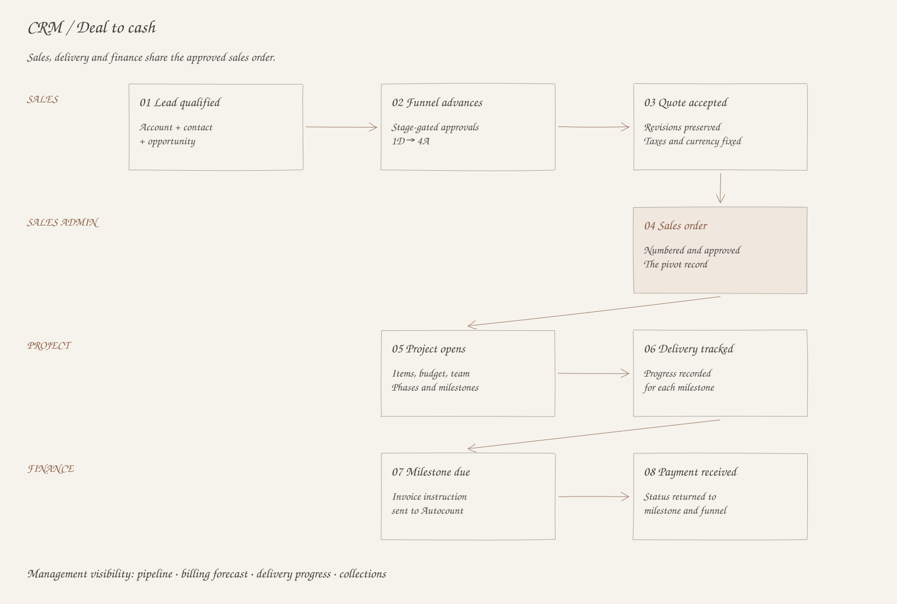
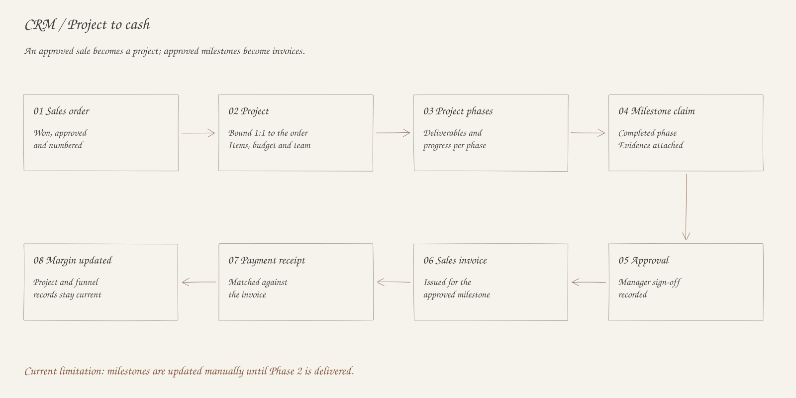
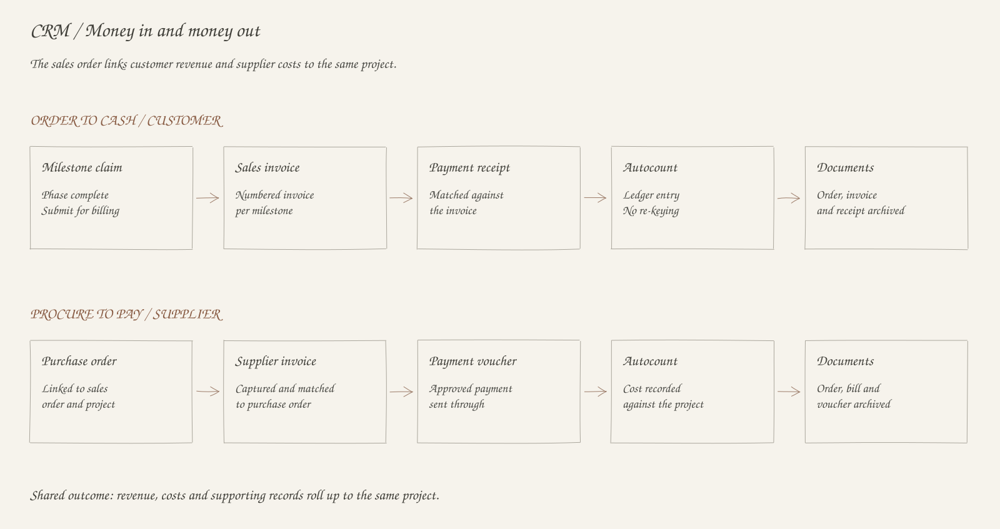

+++
title = "Why We Built an Internal CRM After Trying Salesforce"
description = "How I map sales, delivery, and finance handovers for an internal CRM at Quandatics."
date = 2026-05-25
updated = 2026-11-17
draft = false
aliases = ["/posts/quandatics-crm-business-transformation/"]

[taxonomies]
categories = ["2026"]
tags = ["business systems", "product management"]

[extra]
lang = "en"
toc = true
comment = true
copy = false
outdate_alert = false
outdate_alert_days = 120
math = false
mermaid = false
featured = false
reaction = true
topic = "Business Transformation"
+++

At Quandatics, I’m working on an [internal CRM](https://app.quandatics.com) connecting sales, project delivery, and finance.

## The choice to build internally

The team had tried Salesforce, but it needed workarounds around our process. We could keep adapting it, change our process, or build internally. We chose to build around the sales, delivery, and finance handoffs.

We control the handoffs, but we also own development, deployment, and support. An established CRM can be the better option when its process fits the business.

I map requirements around what each team needs before it can act: the approved scope, supporting documents, current status, and who owns the next step.

## From lead to sales order

A qualified lead becomes an account, a contact, and an opportunity. An account can have several opportunities, each with its own sales funnel and approvals.

A won opportunity's approved quotation becomes a numbered sales order. The order links the sale to a project with its items, budget, team, phases, and milestones.

<figure class="crm-artifact">
  
  <figcaption>Lead to approved sales order.</figcaption>
</figure>

## From delivery to payment

Each project phase has deliverables and a progress percentage. When a phase is done, the team submits a milestone claim with evidence, and management approves it before finance invoices.

The same records show delivery progress, billed amounts, receipts, and outstanding payments, so finance and delivery do not reconstruct the status separately.

### From completed work to invoice-ready

Completed delivery and invoice readiness are different stages. A completed milestone describes the work; invoice readiness also depends on the supporting evidence and management approval finance needs to act.

I use this handover to connect the requirements of the three teams:

- **Sales:** the approved scope provides the reference for what was agreed.
- **Delivery:** the completed milestone and its supporting evidence explain what has been delivered.
- **Finance:** the milestone claim and management approval provide the basis for issuing the invoice.

My contribution is translating those handovers into requirements and supporting implementation, testing, and feedback. The product work is not just recording that a task is complete. It is making the next team's required information, approval, and responsibility clear. Invoice-ready does not mean that an invoice has been issued or payment received.

<figure class="crm-artifact">
  
  <figcaption>Delivery milestone to collected payment.</figcaption>
</figure>

## Customer receipts and supplier costs

For customers, a milestone claim becomes a sales invoice, then a matched receipt. The accounting entry goes to Autocount with supporting documents.

For suppliers, a purchase order links to the sales order. Finance matches the supplier invoice to it, approves a payment voucher, and posts the cost to the project.

<figure class="crm-artifact">
  
  <figcaption>Money in and money out.</figcaption>
</figure>

## My role

I work across requirements, design, development, production deployment, and support. I clarify who owns each record, what each status means, and what happens when scope changes or approval is late.

For a milestone claim, I define the evidence and approval finance needs before invoicing. I settle ownership and approvals before adding fields or screens. Support shows the gaps, such as an incomplete claim or a late handover.

The internal CRM is in daily use, with further modules in development. Client-specific implementation details and operational results remain confidential.
