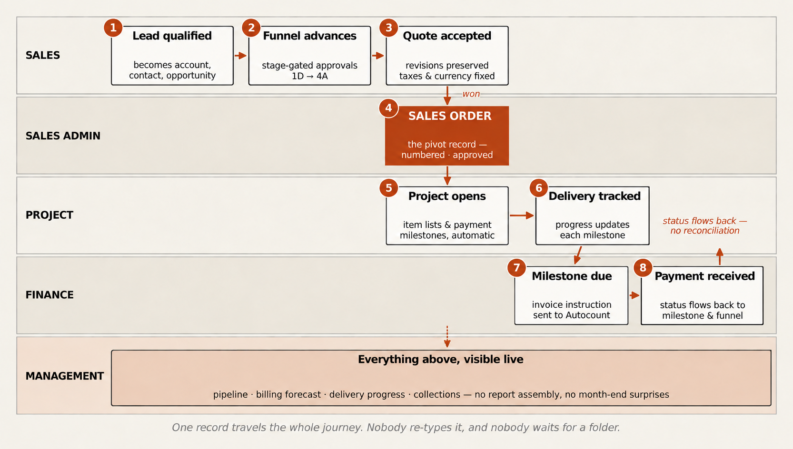
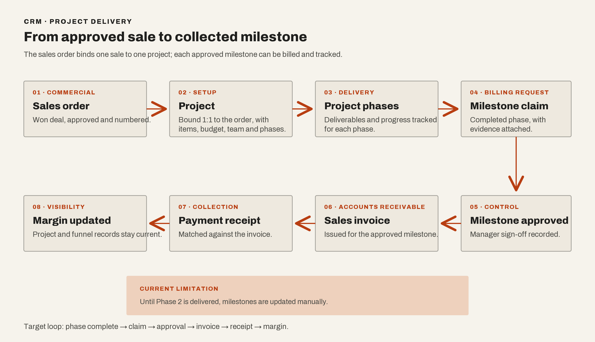
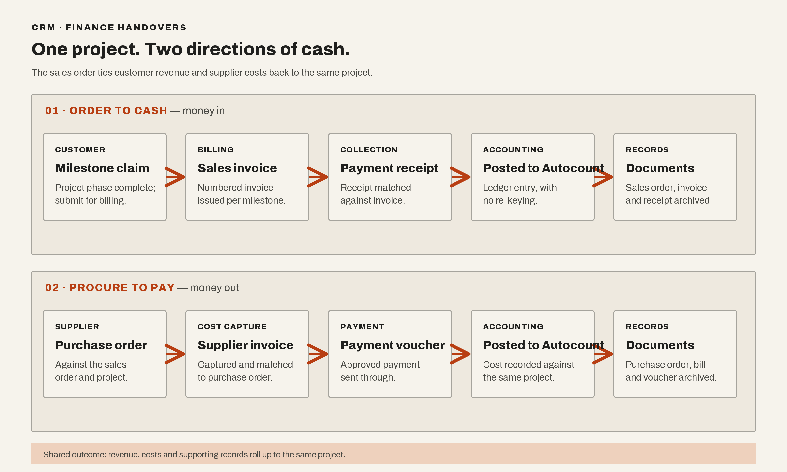

+++
title = "Why We Built an Internal CRM After Trying Salesforce"
description = "A personal case study on adapting a CRM to the way a team actually works."
date = 2026-05-25
updated = 2026-05-25
draft = false
aliases = ["/posts/quandatics-crm-business-transformation/"]

[taxonomies]
categories = ["2026"]
tags = ["business transformation", "product management", "CRM", "automation"]

[extra]
lang = "en"
toc = true
comment = true
copy = false
outdate_alert = false
outdate_alert_days = 120
math = false
mermaid = false
featured = false
reaction = true
topic = "Business Transformation"
+++

When someone asks why we did not use an existing CRM, that is a fair question. The team had already tried Salesforce.

Salesforce is not a bad product. It has more features than most teams will ever use, and that was part of the problem for us. The issue was not that Salesforce could not store a customer or track a deal. It could. The issue was that the team's way of working did not fit neatly into the structure Salesforce expected.

The more we tried to make it work, the more the workflow had to bend around the tool. A process that made sense to the people doing the work became a set of fields, stages, and workarounds. The CRM was there, but it was not really helping people understand what needed to happen next.

That is the background to the internal CRM I am working on with Quandatics. It connects sales, finance, and project teams. I am not trying to build a smaller Salesforce for the sake of building one. The point is to start with the work and then decide what the system actually needs to remember.

## The messy part is between the teams

Sales may begin with a conversation with a customer. Finance may need a different set of information before anything can be invoiced. The project team then needs to know what was promised, what has been approved, and who is responsible for the next step.

On paper, these can look like separate processes. In real life, they are connected by handovers. Someone sends a message. Someone updates a spreadsheet. Someone remembers that a customer asked for a change three weeks ago. Then another person has to reconstruct the whole story before making a decision.

That is the kind of problem an internal CRM can help with. It can make the important handovers visible without making every activity look uniform.

This also explains why a field such as “project status” is not as simple as it sounds. Who is allowed to change it? Does “in progress” mean that work has started, or only that the project has been approved? What happens if the project is waiting for the customer? Who needs to know when the status changes?

These questions decide how the organisation wants work to move, even though they eventually appear as UI details.

## The flow we are trying to represent

The sales process starts with a lead. Once the lead is qualified, it becomes an account, a contact, and an opportunity. An account can have more than one opportunity, so the CRM cannot treat the customer record and the sales funnel as the same thing.

Each opportunity then moves through its own funnel. The stages are more than labels for a salesperson. They carry information about what has been checked, what still needs approval, and whether the opportunity is ready to move forward. Management controls sit around the stages because a quotation should not become a commitment just because someone dragged a card across a screen.

<figure class="crm-artifact">
  
  <figcaption>01 · Lead to approved sales order<a href="../../img/blog/quandatics/deal-to-cash-portfolio.png">View full-size diagram</a></figcaption>
</figure>

When the opportunity is won, the quotation is finalised. The approved quotation becomes a numbered sales order. That sales order is the record that joins the commercial side to the delivery side. It binds one sale to one project, with the project carrying the item list, budget, team, phases, and milestones.

This is where the data needs to stop being retyped. If the project team has to rebuild the project from an email or a PDF, the connection has already been lost.

## The project has to agree with the sale

The project does not disappear after the sales order is created. It opens from the order and moves through its delivery phases. Each phase has deliverables and a progress percentage. When a phase is complete, the team can submit a milestone claim with the evidence needed for approval.

Management then approves the milestone. Once it is approved, finance can issue the sales invoice for that milestone. The project status and the payment status need to travel back to the same records, so the business can see whether a project is progressing, whether it has been billed, and whether the money has actually been collected.

<figure class="crm-artifact">
  
  <figcaption>02 · Delivery milestone to collected payment<a href="../../img/blog/quandatics/project-to-cash-portfolio.png">View full-size diagram</a></figcaption>
</figure>

The relationship between a project milestone and a payment is important. Finance needs to know which milestone is due, how much should be collected, how much has already been received, and what remains outstanding. The project team needs to know the same thing from the other direction. A project can be technically progressing while its billing is behind, or it can be billed while the delivery evidence is still incomplete.

## Finance runs in two directions

The money-in side is the order-to-cash process. A completed project milestone becomes a claim, then a sales invoice, then a payment receipt matched against that invoice. The accounting entry is posted to Autocount, with the relevant sales order and documents kept together.

At the same time, the money-out side is procure-to-pay. A purchase order goes to a supplier or subcontractor against the sales order. The supplier invoice is captured and matched to the purchase order, then an approved payment voucher sends the payment through. The cost is posted back to the same project.

<figure class="crm-artifact">
  
  <figcaption>03 · Money in and money out<a href="../../img/blog/quandatics/o2c-p2p-portfolio.png">View full-size diagram</a></figcaption>
</figure>

This is the part I find easy to miss when looking at a CRM as only a sales tool. The sales funnel is also connected to future revenue, project delivery, supplier costs, and margin. If those links are missing, management has to assemble the answer manually whenever they want to know what is happening.

## I had to learn the process before designing the system

My first instinct was to think about the screens. It is easy to imagine a dashboard and feel that the project is moving forward. The harder part is sitting with the workflow long enough to notice where the words stop matching the work.

I have been working across requirements, design, development, production deployment, and support. That means moving between conversations with the people who operate the process and the technical decisions needed to turn it into a working system.

Sometimes a requirement sounds clear until someone asks what happens in the exception. Sometimes two teams use the same word but mean different things by it. Sometimes a field exists because somebody needed it once, but nobody can explain who owns it now.

Those are the moments where the product work happens. I translate the operating problem into something the team can discuss, decide what belongs in the system, and help turn that decision into work that can be tested.

The support part has been useful for the same reason. A workflow can look complete in a meeting and still break when a customer changes scope, an approval arrives late, or the previous handover leaves out an important detail. Those cases are not annoying side stories. They show us where our understanding of the process was incomplete.

## How much should the tool change the team?

There is a reasonable argument for doing exactly that. Standardising a process can make it easier to train people and easier to report on. Sometimes the organisation really does need to change the way it works.

But there is a difference between choosing a better process and forcing a team to imitate the shape of a piece of software. If people have to maintain a second spreadsheet, keep private notes, or create workarounds just to make the CRM usable, then the standardisation has not solved much.

The right answer is not always custom software. An established CRM may be the best choice when its assumptions match the business, or when changing the business process is worth the trade-off. In this case, the team had already felt the cost of adapting its workflow to Salesforce, so an internal system became worth exploring.

The lesson I am taking from the project is quite simple. A CRM should reduce the amount of context people have to reconstruct before they can act. It should help someone see what happened, what is missing, and who owns the next step.

That sounds less impressive than “digital transformation”, but it is much closer to what the work actually is.

This post describes the general problem and my role. Client-specific workflows, implementation details, and operational results remain confidential.
