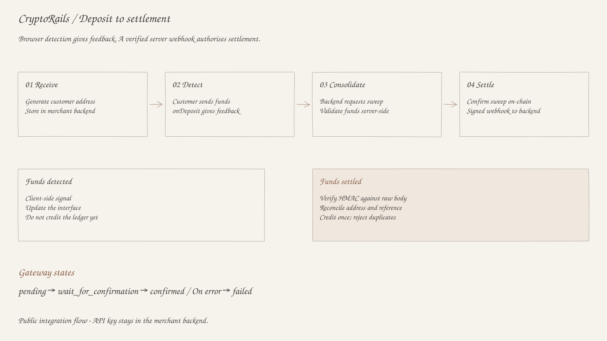

+++
title = "CryptoRails: From Deposit to Settlement"
description = "Deposit detection, consolidation, and verified-webhook settlement across EVM and TRON."
date = 2026-08-02
updated = 2026-08-02
draft = false
aliases = ["/posts/cryptorails-transaction-lifecycle/", "/blog/cryptorails-transaction-lifecycle/"]

[taxonomies]
categories = ["2026"]
tags = ["web3", "product management", "payments"]

[extra]
lang = "en"
toc = true
comment = true
copy = false
outdate_alert = false
outdate_alert_days = 120
math = false
mermaid = false
featured = false
reaction = true
topic = "Web3"
+++

CryptoRails accepts crypto deposits and consolidates them into a merchant’s wallet. In the documented integration, the browser detects incoming funds, while a verified server webhook authorises settlement.

I coordinate product delivery across payment flows, EVM and TRON integration, QA, and UI testing. These are the states and failure cases I need to account for in the backlog.

## Deposit detection and consolidation

The merchant generates a deposit address for each customer and stores it in its backend. The API key stays on the server. The customer sends funds to that address through the deposit modal or a custom interface.

The browser’s `deposit-watch` SDK polls the chain and fires `onDeposit` when funds appear. The callback updates the interface and notifies the merchant backend. The backend requests consolidation; CryptoRails validates the funds and sweeps them into the tenant’s consolidation wallet.

<figure class="payment-artifact">

<figcaption>Redrawn from the <a href="https://docs.cryptorails.tech/guide">public integration guide</a>: detection provides feedback; a verified webhook authorises settlement. <a href="../../img/projects/cryptorails-deposit-flow-excalidraw.svg">View full-size diagram</a></figcaption>
</figure>

## Confirmation and settlement

The gateway tracks consolidation and withdrawal transactions through `pending`, `wait_for_confirmation`, `confirmed`, or `failed`. These are separate from the browser’s deposit-detection state.

After consolidation confirms, the gateway sends a signed webhook. The merchant backend verifies the HMAC signature against the raw request body, reconciles the address and reference, and credits the ledger once. Duplicate delivery must not create duplicate credit.

## EVM and TRON costs

EVM transactions normally use the network’s native coin for gas. TRON token transfers use Energy and may consume Bandwidth. Without enough Energy, a transfer can burn TRX to cover the shortfall.

The gateway applies Energy rental before resource-heavy TRON transactions. Chain-specific resource checks, confirmation conditions, and wallet errors belong in the requirements and QA cases.

## Cases the team has to test

- Wrong network, token, recipient, or amount.
- Wallet rejection or a delayed transaction.
- Late RPC or indexing responses.
- Repeated requests and duplicated webhooks.

Each case needs a defined response: wait, retry, reject, or review. The interface must show pending work without suggesting that settlement has completed.

## My part in delivery

I contribute to the backlog and roadmap, run Scrum ceremonies, and coordinate the engineering team. I work with the business owner and engineers to define which event permits settlement, what the user sees while waiting, and how retries avoid duplicate credit.

Try the [live deposit interface](https://docs.cryptorails.tech/guide/playground), or read the [integration guide](https://docs.cryptorails.tech/guide), [transaction overview](https://docs.cryptorails.tech/documentation/overview), and [webhook documentation](https://docs.cryptorails.tech/documentation/webhooks). Internal implementation details and performance results remain confidential.

## Related product decisions

- [How I define when a payment is complete](@/blog/product-manager-between-business-and-delivery.md).
- [TRON energy as a product requirement](@/blog/tron-energy-product-requirement.md).
