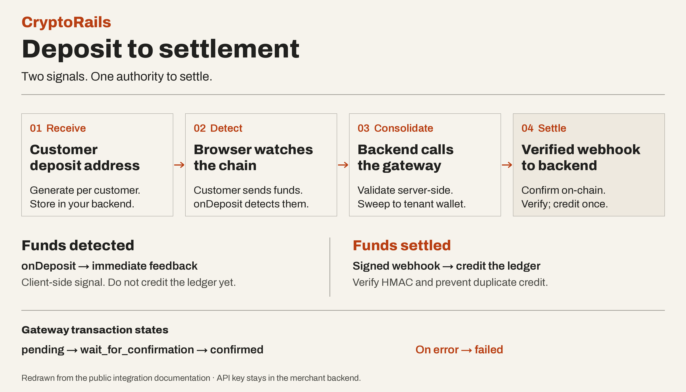

+++
title = "Designing a Web3 Payment Transaction Lifecycle Across EVM and TRON"
description = "How a usable crypto payment gateway moves a payment from checkout to confirmation and settlement."
date = 2026-08-02
updated = 2026-08-02
draft = false
aliases = ["/posts/cryptorails-transaction-lifecycle/", "/blog/cryptorails-transaction-lifecycle/"]

[taxonomies]
categories = ["2026"]
tags = ["web3", "product management", "payments"]

[extra]
lang = "en"
toc = true
comment = true
copy = false
outdate_alert = false
outdate_alert_days = 120
math = false
mermaid = false
featured = false
reaction = true
topic = "Web3"
+++

CryptoRails is a payment gateway that people can actually use to accept crypto payments. It is closer in spirit to a simple Stripe-style checkout and settlement product than to a research prototype. The feature set is still focused, but the main payment functionality is there.

The question I keep coming back to is quite ordinary. When can we honestly tell someone that the money has arrived?

The screen may show a transaction hash almost immediately. That is useful, but it is not the same as a confirmed payment. The backend still has to match the transaction to the original request, check what happened on-chain, and decide whether it is safe to settle.

That gap between “the wallet says something happened” and “the business can act on it” is where much of the product work lives. Even a simple payment gateway has to get this part right.

## A transaction hash is only one part of the story

In the documented integration, the merchant generates a deposit address for each customer and stores it in its own backend. The frontend shows that address through a deposit modal or a custom interface. The API key stays on the server.

The hash belongs to the blockchain. The payment reference belongs to the business request. Keeping both is what lets the backend answer a fairly important question later: is this the payment we were expecting, or is it only a transaction that happens to exist?

The customer sends funds to the deposit address. The browser’s `deposit-watch` SDK polls the chain and fires `onDeposit` when funds appear. That callback gives immediate feedback and notifies the merchant’s backend; it is not proof of settlement.

<figure class="payment-artifact">
  
  <figcaption>Redrawn from the <a href="https://docs.cryptorails.tech/guide">public integration guide</a>: detection provides feedback; a verified webhook authorises settlement.</figcaption>
</figure>

The merchant’s backend requests consolidation. CryptoRails validates the on-chain funds and sweeps them from the deposit address to the tenant’s consolidation wallet. The gateway tracks this transaction through confirmation before sending the signed webhook.

That distinction sounds obvious when written down. It becomes less obvious when a customer is waiting, a merchant is asking whether an order can be released, and the transaction is taking longer than expected.

## The network changes the work

Supporting EVM networks and TRON does not mean putting two names into a dropdown and calling the problem solved.

On an EVM network, the transaction normally needs the network's native coin to pay gas. A TRON token transfer depends on TRON resources, especially Energy, and may also use Bandwidth.

For TRON, the gateway applies Energy rental before a resource-heavy transaction is broadcast. Without enough Energy, the transfer can burn TRX to cover the missing resource. The transaction may succeed, but the cost can be surprisingly high. That makes Energy part of the product flow, not a detail to leave for the user to discover afterwards.

The chain also affects monitoring, confirmation, wallet compatibility, error handling, and QA. The broad sequence is shared, but the conditions inside each step are not identical. Confirmation rules need to come from the implementation and the selected network, not from a label in the interface.

## The waiting part is part of the product

After broadcast, the system has to keep checking. Has the transaction appeared? Is it still processing? Did it fail? Has it reached the confirmation condition required by the product?

The interface should make those states understandable. “Waiting for the network” gives the user something useful. A raw RPC error usually does not. At the same time, the interface should not turn a pending transaction into a success message just to make the screen feel finished.

The gateway documentation describes a backend lifecycle with states such as `pending`, `wait_for_confirmation`, `confirmed`, and `failed`. These describe the gateway’s consolidation or withdrawal transaction, rather than the browser’s deposit detection.

When the consolidation confirms, the merchant can reconcile the signed webhook with the deposit recorded earlier, using the address and reference. This must remain safe when the same webhook is delivered twice. A customer should not receive credit twice because an event was delivered twice.

The final signal is sent to the product through a signed webhook. The receiving backend should verify the HMAC signature against the raw request body before trusting the payload. That server-side event can then update a ledger, release an item, or tell a merchant that the payment is complete.

The client-side signal still has a job. It can tell the user that funds have been detected quickly. It should not be the authority for settlement.

## The unhappy paths are where the design gets tested

The payment can be sent on the wrong network, use the wrong token, or arrive with the wrong amount. The request can expire. The transaction can be delayed, dropped, or rejected by the wallet. An indexing service or RPC can be late. A webhook can be duplicated.

These are different problems. Some need a retry. Some need a manual review. Some should be rejected permanently. Putting all of them into one “failed” state makes the system easier to code and harder to operate.

This is also why I care about the payment state shown in the UI. It affects what the customer does next, what the merchant believes, and what the delivery team has to test.

## Where I sit in the work

My role sits between the business owner and the delivery team. I contribute to the backlog and roadmap, run Scrum ceremonies, and coordinate an engineering team working across payment flows, EVM and TRON integration, QA, and UI/UX testing.

The work is partly about writing requirements. It is also about asking the annoying question before the team has already built the wrong thing. What happens if the transaction is late? Which event is authoritative? What should the user see while the chain is still processing? What stops a retry from crediting the same payment twice?

Those questions connect the technical state of the system to the experience people actually have. The gateway is simple for now, but it is already usable. A payment is not complete because one screen says it is. It is complete when the system has enough verified evidence to treat it as settled.

To see the actual deposit interface, try the [live SDK playground](https://docs.cryptorails.tech/guide/playground).

For the public technical reference, see the [CryptoRails payment gateway documentation](https://docs.cryptorails.tech/), especially the [integration guide](https://docs.cryptorails.tech/guide), [transaction overview](https://docs.cryptorails.tech/documentation/overview), and [webhook documentation](https://docs.cryptorails.tech/documentation/webhooks).

This is a generalised case study. Product-specific business details, implementation details, and performance results remain confidential.
